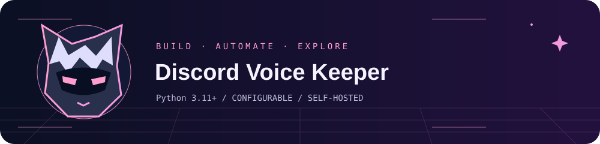

<!-- discord-presence:start -->
<p align="center">
  <a href="https://discord.com/users/891081797318897715">
    
  </a>
</p>
<!-- discord-presence:end -->



# Discord Voice Keeper

A silent Discord bot that remembers one voice channel and maintains its connection.

**Runtime:** Python 3.11+ · **Configuration:** environment variables · **Deployment:** self-hosted

## Quick start

The supported deployment target is Linux. Create an isolated Python environment:

```sh
python3 -m venv venv
. venv/bin/activate
python -m pip install -r requirements.txt
cp .env.example .env
# Edit .env first. Use shell-compatible quoting for JSON and values with spaces.
set -a
. ./.env
set +a
python bot.py
```

Only source a configuration file you created and trust. Starting the application can connect to external services; configure credentials and destinations first.

## Usage

Invite the bot with slash-command access and View Channel / Connect permissions. Use `/stay` as an administrator to choose a room, then `/status` to inspect the saved destination. EXPECTED_BOT_ID must match the application whose token you configure.

## Command groups

| Command | Purpose |
| --- | --- |
| `/stay` | Admin: keep this bot in a voice room permanently |
| `/status` | Check the saved room and current connection |

Discord provides subcommands and argument descriptions when you type a command.

## Configuration

`.env.example` contains placeholders only. Real credentials, IDs, storage locations and account settings belong in your private local configuration.

| Variable | Requirement |
| --- | --- |
| `DISCORD_GUILD_ID` | Discord guild in which to register commands. |
| `DISCORD_TOKEN` | Discord bot token; keep it secret. |
| `EXPECTED_BOT_ID` | Expected Discord application/bot ID; startup checks the token identity. |

## How it works and operational notes

The selected channel is stored in `data/state.json`. Voice support requires the native dependencies used by discord.py voice, including an Opus library on Linux. Voice and AFK behavior must be checked in your own guild.

## Project layout

- Source files implement the application and integrations.
- `requirements.txt` or the project file declares dependencies.
- `.env.example` documents configuration names without live values.
- `.gitignore` excludes credentials, sessions, generated data and build output.
- `assets/banner.svg` is an original animated vector illustration. It has a static fallback and respects reduced-motion preferences in supporting viewers.

## Verification

See [VALIDATION.md](VALIDATION.md) for the checks performed on this publication snapshot and the remaining deployment checks. A source check is not an end-to-end test of Discord, Telegram, music sites or your host.

## Privacy and upstream services

This repository is a configurable source distribution. It does not include a production database, personal saved-link collection, message archive, credentials, media library or existing Git history. Review local changes before committing them.

Third-party APIs, libraries and products remain the work of their respective maintainers. Review their terms and licenses before redistribution or deployment. The original project artwork is stored locally; it does not depend on a remote GIF or tracking service.
